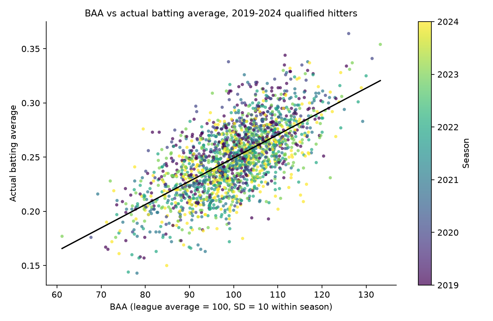

# Batting Average Ability (BAA)

**How much of a hitter's batting average is skill, and how much is luck? A mixed-effects model on FanGraphs 2015–2024 data separates the two.**

[Results](#results) · [Main notebook](notebooks/batting_average_model.ipynb) · [Output tables](data/predictions/) · [Reproduce](#run-it) · [Citation](#citation)

## Summary

I built BAA, a season-indexed metric, from a player-random-intercept mixed-effects model. It estimates the skill part of a hitter's batting average from plate discipline and quality of contact, and reports the leftover (actual minus predicted) as luck. The data is 4,374 FanGraphs player-seasons (2015–2024, min 100 PA, 1,173 players). About a quarter of the variance in batting average (ICC ~24.7%) comes from persistent player skill, and the model explains 45.7% of held-out variance from peripheral stats alone.

<p align="center"></p>
<p align="center"><sub>BAA against actual batting average, 2019–2024 seasons with at least 200 PA, colored by season. Drawn from <code>data/predictions/baa_coefficients_output_no_predbabip.csv</code>; the notebook's last cell makes an interactive version.</sub></p>

## Results

Same-season models on a random 80/20 split (3,499 train / 875 test player-seasons).

| Model | Target | Test R² | Test MAE | Notes |
|---|---|---|---|---|
| Linear regression | BABIP | 0.402 | 0.0253 | Baseline |
| Mixed effects (CLR features) | BABIP | 0.347–0.372 | 0.026 | ICC 0.184. Range explained below. |
| **Mixed effects (predicted BABIP + discipline)** | **AVG** | **0.457** | **0.0215** | **ICC 0.247. The model behind BAA.** |

- A linear AVG model scores R² 0.983, but it uses same-season BABIP as an input, so it is close to an accounting identity and not a skill result.
- Random forest for BABIP was rejected: test R² 0.293 against 0.372 for the linear baseline, with an overfit gap of 0.166 versus 0.027 (`models/babip_model_comparison.csv`).
- Sprint speed is the second-biggest BABIP driver after batted-ball trajectory (standardized coefficient +0.0087, p < 0.001).
- Face validity: Luis Arraez 2023 scores BAA 133.2 (actual AVG .354); Joey Gallo 2023 scores 61.2 (.177). BAA is indexed to mean 100 and SD 10 within each season, so scores compare across years.
- Fitting actual AVG on BAA within each season gives R² from 0.409 (2023) to 0.527 (2021), 0.425 in 2024.

## Method

1. Clean the FanGraphs pull and split 80/20 (`random_state` 42).
2. Model BABIP with player random intercepts on a centered-log-ratio transform of batted-ball composition (LD/GB/FB), weighted by plate appearances.
3. Model AVG from predicted BABIP plus plate-discipline features (K%, BB%, swing and contact rates).
4. Combine the standardized coefficients into BAA, indexed within each season. Seasons under 200 PA are excluded from the index.

## Repository layout

```
notebooks/
  batting_average_model.ipynb   Main pipeline: clean, split, model, index, validate
  BA_dict.ipynb                 Standalone warm-up (name to batting-average lookup)
data/
  raw/                          Baseball Savant export, used only by BA_dict
  processed/                    Cleaned dataset, train/test split, model features
  predictions/                  Model predictions and the BAA tables
models/                         Fitted models, coefficients, BABIP model comparison
figures/                        README figure
```

## Run it

```bash
pip install -r requirements.txt
jupyter notebook notebooks/batting_average_model.ipynb
```

Open the notebook from `notebooks/` (paths are relative to that folder) and run it top to bottom. The first cell re-downloads FanGraphs data through `pybaseball`, so it needs internet. The committed CSV and model files let you inspect every result without running anything.

## Limitations

- This isolates skill, it doesn't forecast. It explains same-season AVG from same-season peripherals, not next season's average. A year-over-year BAA stability test is the natural next step and is not built.
- The 80/20 split mixes seasons and there is no cross-validation, so the R² values are not out-of-time estimates.
- The BABIP model's test R² is 0.347 in the current notebook run but 0.372 in the saved `babip_final_model_info.txt`. The two runs were fit slightly differently and I haven't reconciled the gap. Don't quote one figure without knowing which run produced it.
- BABIP prediction intervals are poorly calibrated: coverage is 54.5%, so they are too narrow.

## Citation

```bibtex
@misc{seluga2026baa,
  title  = {Batting Average Ability: Separating Hitter Skill from Luck with Mixed-Effects Models},
  author = {Seluga, Nate},
  year   = {2026},
  url    = {https://github.com/nseluga/Batting-Average-Ability}
}
```

Data: season-level batting stats from [FanGraphs](https://www.fangraphs.com) via [pybaseball](https://github.com/jldbc/pybaseball), `batting_stats(year, qual=100)` for 2015–2024. The Baseball Savant export in `data/raw/` is used only by the warm-up notebook.
